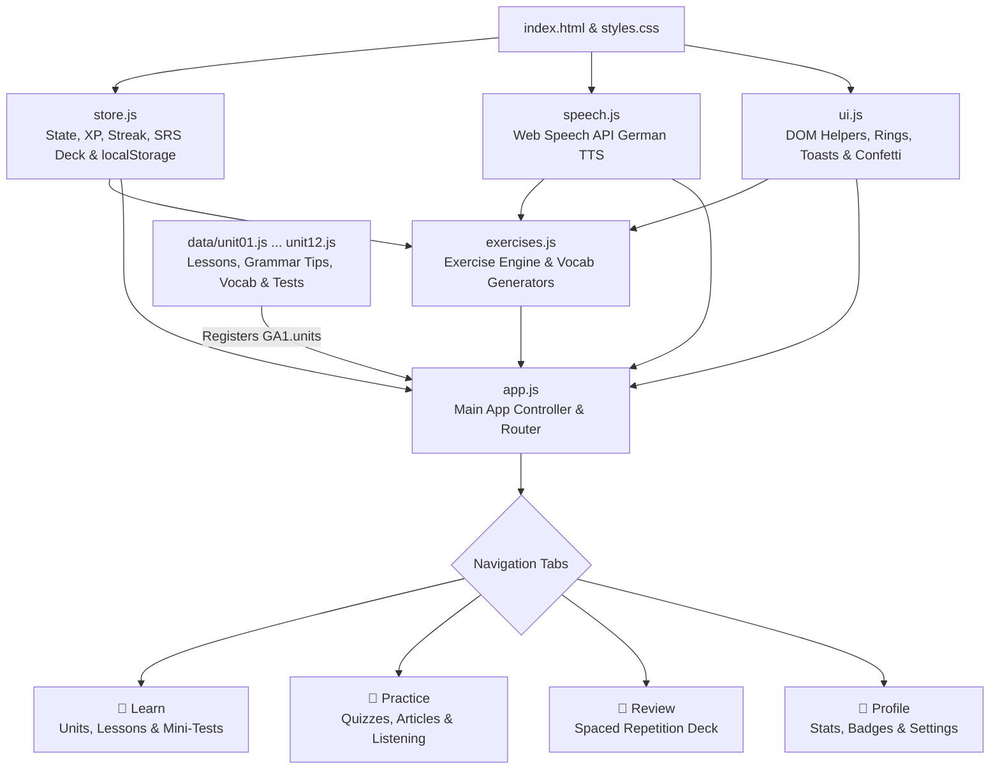
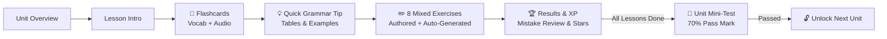

# 🇩🇪 Deutsch A1 — Interactive German Learning Web App

An interactive, client-side web application designed to take learners from zero to **CEFR Level A1** in German. Built with zero external dependencies using vanilla HTML, CSS, and JavaScript, it combines structured lessons, interactive flashcards, automated exercise generation, Text-to-Speech (TTS) audio drills, gamification, and a Spaced Repetition System (SRS) in a sleek, mobile-first interface.

---

## ✨ Key Features

- **📚 Complete 12-Unit A1 Curriculum:** Covers everything from the German alphabet and pronunciation to modal verbs, imperatives, and a **Goethe A1-style Mock Exam**, featuring 60+ structured lessons and unit mini-tests.
- **🧠 7 Interactive Exercise Modes:**
  - Multiple Choice (`mcq`)
  - Listening Comprehension with slow-playback option (`listen`)
  - Word & Pair Matching (`match`)
  - Gender & Article Trainer — `der`, `die`, `das` (`article`)
  - Fill-in-the-Blank (`fill`)
  - Sentence Builder / Word Ordering (`order`)
  - German Typing with built-in special character bar `ä, ö, ü, ß` and lenient umlaut validation (`type`)
- **🃏 Interactive Flashcards & Audio:** Built-in Web Speech API integration (`speech.js`) for native German pronunciation, adjustable speech speeds (Slow, Normal, Fast), and autoplay controls.
- **🔁 Spaced Repetition Review Deck:** Automatically tracks missed words and schedules them across 5 mastery boxes at growing intervals so weak vocabulary stays fresh.
- **🎯 Dedicated Practice Hub:** Unlockable Quick Quizzes, Article Trainers, Listening Drills, Unit Flashcard decks, and searchable Vocabulary Lists with instant audio playback.
- **🏆 Gamification & Progress Tracking:** Daily XP goals, learning streaks, weekly activity bar charts, level progression, unlockable badges, and an A1 completion certificate—all persisted locally in the browser (`localStorage`).
- **⚡ Zero Dependencies & Offline-Ready:** Pure modular ES5/ES6 JavaScript architecture (`window.GA1` namespace) with no build steps, bundlers, or backend servers required.

---

## 🏗️ Architecture & Module Links Diagram

The application follows a clean, modular client-side architecture where data modules register themselves into a shared global namespace (`window.GA1`) orchestrated by `app.js`:



---

## 🔄 Lesson & Learning Flow



---

## 📂 Project Structure

```text
learning-Deutsch/
├── index.html          # Main application entry point and viewport shell
├── styles.css          # Responsive mobile-first UI styling, themes & animations
├── app.js              # Core controller, screen router, tab navigation & event dispatcher
├── store.js            # LocalStorage persistence, XP/level math, streaks, badges & SRS logic
├── speech.js           # Browser Text-to-Speech (de-DE) wrapper and voice detection
├── exercises.js        # Exercise runners, answer normalization & dynamic quiz generators
├── ui.js               # Reusable UI components (progress rings, modals, toasts, confetti)
└── data/               # Modular curriculum content (self-registering into GA1.units)
    ├── unit01.js       # Unit 1: Alphabet & Pronunciation
    ├── unit02.js       # Unit 2: Greetings & Introductions
    ├── unit03.js       # Unit 3: Numbers, Time & Dates
    ├── unit04.js       # Unit 4: Family & People
    ├── unit05.js       # Unit 5: Food & Drink
    ├── unit06.js       # Unit 6: Daily Routine & Hobbies
    ├── unit07.js       # Unit 7: Shopping
    ├── unit08.js       # Unit 8: House & Home
    ├── unit09.js       # Unit 9: Travel & Directions
    ├── unit10.js       # Unit 10: Grammar Fundamentals
    ├── unit11.js       # Unit 11: Modal Verbs & Imperative
    └── unit12.js       # Unit 12: A1 Review & Final Exam
```

---

## 📖 Curriculum Overview

| Unit | Title | Focus Areas |
| :--- | :--- | :--- |
| **01** | 🔤 Alphabet & Pronunciation | German alphabet, umlauts (`ä, ö, ü`), `ß`, consonant clusters (`ch, sch, sp, st`), vowel pairs, spelling |
| **02** | 👋 Greetings & Introductions | Time-of-day greetings, `heißen / kommen / wohnen`, `du` vs. `Sie`, `sein`, countries, W-questions |
| **03** | 🔢 Numbers, Time & Dates | Numbers 0–100, days of the week, months, formal & informal clock time, prices, ordinal dates |
| **04** | 👨‍👩‍👧‍👦 Family & People | Family vocabulary, possessives (`mein, dein, sein, ihr`), `haben`, physical descriptions, jobs & age |
| **05** | 🍽️ Food & Drink | Meals, groceries, gender hints & plural patterns, café ordering, `möchten`, `mögen` & tastes |
| **06** | ⏰ Daily Routine & Hobbies | Present-tense conjugation, separable verbs (`aufstehen`), `gern / lieber / am liebsten`, `nicht` vs. `kein` |
| **07** | 🛍️ Shopping | Clothes & colors, shops & markets, asking prices, accusative case (`den, einen, keinen`), adjectives |
| **08** | 🏠 House & Home | Rooms, furniture & compound nouns, `es gibt` + accusative, location prepositions + dative (`Wo?`) |
| **09** | ✈️ Travel & Directions | Transport (`mit` + dative), train tickets & stations, giving directions, hotel bookings, weather & seasons |
| **10** | 🧩 Grammar Fundamentals | Nominative vs. accusative, case prepositions (`für, ohne, mit, bei`), personal pronouns, V2 word order |
| **11** | 🗝️ Modal Verbs & Imperative | `können, müssen, wollen, dürfen, möchten`, sentence bracket (*Satzklammer*), imperatives, appointments |
| **12** | 🎓 A1 Review & Final Exam | Comprehensive grammar review, reading comprehension, listening drills & Goethe A1 mock exam |

---

## 🚀 Getting Started

Because the app is built entirely with static web technologies, no installation or build tools are needed:

1. **Clone the repository:**
   ```bash
   git clone https://github.com/peter1girgis/learning-Deutsch.git
   cd learning-Deutsch
   ```
2. **Run the app:**
   - Open `index.html` directly in any modern web browser, **or**
   - Serve it locally for the best experience:
     ```bash
     npx serve .
     # or using Python
     python3 -m http.server 8080
     ```
3. **Enable German Audio (Optional):** Ensure a German (`de-DE`) Text-to-Speech voice is installed in your OS/browser settings for listening drills and pronunciation playback.

---

## 🛠️ How It Helps Learners & Developers

- **For Self-Paced Learners:** Eliminates the overwhelm of German grammar by pairing bite-sized, visual grammar tables with immediate active recall exercises and automatic mistake recycling.
- **For Developers & Educators:** Offers an extensible, data-driven architecture—adding a new unit or custom vocabulary lesson only requires dropping a new file into `data/` following the `GA1.units.push({...})` schema, and the exercise engine automatically generates quizzes, flashcards, and listening drills from the vocabulary list.
